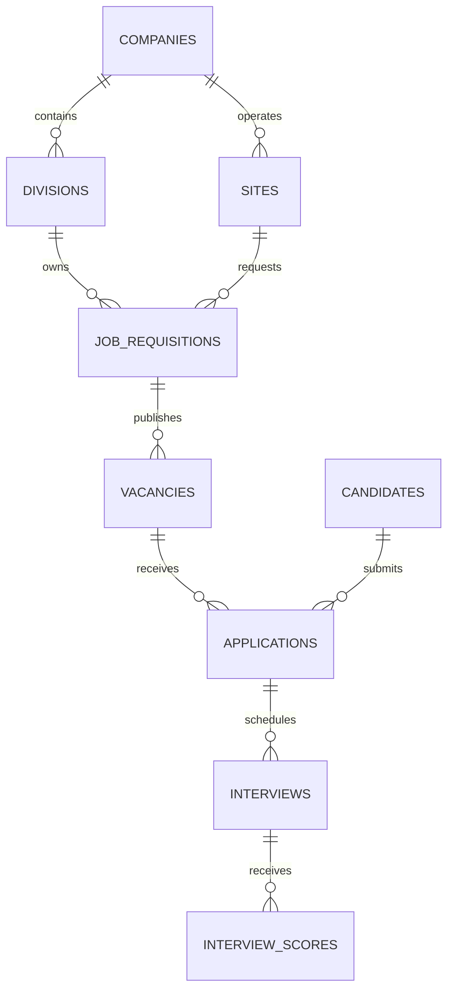
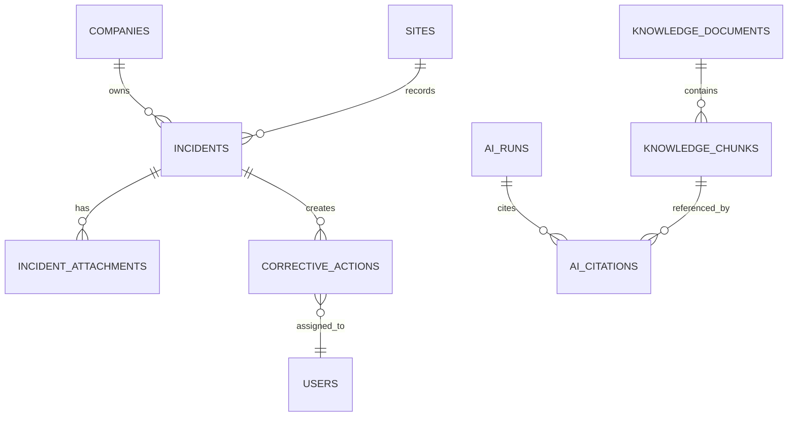

# Entity Relationship Design

## 1. Design Principles

- One root database for both bounded applications.
- Shared organisation, site, identity, document, job, audit, and reporting entities.
- Every operational record is scoped to a company and, where relevant, a site.
- Candidate decisions and HSE severity decisions remain human-controlled.
- Local files are referenced by controlled relative paths, never public URLs.

## 2. Main Entities

### Organisation

- `companies`
- `divisions`
- `sites`
- `job_families`

### Identity and access

- `users`
- `roles`
- `user_roles`
- `user_scopes`

### Recruitment

- `job_requisitions`
- `vacancies`
- `candidates`
- `candidate_documents`
- `applications`
- `interviews`
- `interview_scores`
- `offers`
- `onboarding_tasks`

### HSE

- `incidents`
- `incident_attachments`
- `corrective_actions`
- `incident_events`

### RAG and AI

- `knowledge_documents`
- `knowledge_chunks`
- `ai_runs`
- `ai_citations`

### Reporting and platform

- `reports`
- `jobs`
- `audit_logs`

## 3. Relationships

## 4. Important Table Fields

### companies

- `id` UUID primary key
- `code` unique string
- `name` string
- `legal_name` nullable string
- `status` enum
- timestamps

### divisions

- `id` UUID primary key
- `company_id` foreign key
- `code` string
- `name` string
- `business_area` enum: chemical, logistics, energy, agriculture, factory, other

### sites

- `id` UUID primary key
- `company_id` foreign key
- `code` string
- `name` string
- `location` string
- `timezone` string
- `site_type` enum: office, warehouse, factory, mine, port, other

### job_requisitions

- `id` UUID primary key
- `company_id` foreign key
- `division_id` foreign key
- `site_id` nullable foreign key
- `job_family_id` foreign key
- `title` string
- `employment_type` enum
- `shift_required` boolean
- `status` enum: draft, pending_approval, approved, rejected, closed
- `required_skills` JSONB
- `required_certifications` JSONB
- `approved_by` nullable user foreign key
- timestamps

### candidates

- `id` UUID primary key
- `full_name` string
- `email` string
- `phone` nullable string
- `location` nullable string
- `consent_status` enum
- `source` string
- timestamps

### candidate_documents

- `id` UUID primary key
- `candidate_id` foreign key
- `document_type` enum: cv, certificate, identity, portfolio, other
- `original_filename` string
- `local_path` string
- `mime_type` string
- `sha256` string
- `parsed_text` nullable text
- `parsed_data` nullable JSONB
- timestamps

### applications

- `id` UUID primary key
- `vacancy_id` foreign key
- `candidate_id` foreign key
- `stage` enum
- `fit_score` nullable numeric
- `fit_explanation` nullable JSONB
- `human_decision` nullable enum
- `created_at`, `updated_at`

### interviews

- `id` UUID primary key
- `application_id` foreign key
- `interviewer_id` foreign key
- `scheduled_at` nullable timestamp
- `status` enum
- `notes` nullable text
- `ai_summary` nullable text
- timestamps

### interview_scores

- `id` UUID primary key
- `interview_id` foreign key
- `competency` string
- `score` integer
- `evidence` text
- `comment` nullable text

### incidents

- `id` UUID primary key
- `company_id` foreign key
- `site_id` foreign key
- `reported_by` foreign key
- `incident_number` unique string
- `incident_type` enum: injury, near_miss, property_damage, environmental, unsafe_act, unsafe_condition, other
- `occurred_at` timestamp
- `area` string
- `description` text
- `immediate_action` nullable text
- `ai_category` nullable string
- `ai_summary` nullable text
- `confirmed_severity` nullable enum: low, medium, high, critical
- `status` enum: draft, submitted, under_review, action_open, closed
- timestamps

### corrective_actions

- `id` UUID primary key
- `incident_id` foreign key
- `description` text
- `owner_id` foreign key
- `due_date` date
- `status` enum: open, in_progress, completed, overdue, cancelled
- `completed_at` nullable timestamp

### knowledge_documents

- `id` UUID primary key
- `company_id` nullable foreign key
- `division_id` nullable foreign key
- `site_id` nullable foreign key
- `document_type` string
- `title` string
- `local_path` string
- `version` string
- `effective_date` nullable date
- `status` enum: pending, indexing, indexed, failed, archived
- `sha256` string
- timestamps

### knowledge_chunks

- `id` UUID primary key
- `document_id` foreign key
- `chunk_index` integer
- `content` text
- `token_count` integer
- `embedding` vector
- `metadata` JSONB

### ai_runs

- `id` UUID primary key
- `user_id` nullable foreign key
- `feature` enum: rag_chat, cv_parse, candidate_match, interview_summary, incident_summary, report_summary
- `provider` string
- `model` string
- `status` enum
- `input_hash` nullable string
- `output_json` nullable JSONB
- `error` nullable text
- timestamps

### ai_citations

- `id` UUID primary key
- `ai_run_id` foreign key
- `document_id` foreign key
- `chunk_id` foreign key
- `quote` nullable text
- `relevance_score` nullable numeric

## 5. Constraints and Indexes

- Unique `(company_id, code)` for companies, divisions, and sites where applicable.
- Unique `(vacancy_id, candidate_id)` for applications.
- Index `knowledge_chunks(document_id)`.
- Vector index on `knowledge_chunks.embedding` after the MVP dataset is stable.
- Index incidents by `(site_id, occurred_at)`.
- Index corrective actions by `(status, due_date)`.
- Add `created_by`, `updated_by`, and timestamps to mutable business records.
- Store all local paths outside the public web root.
